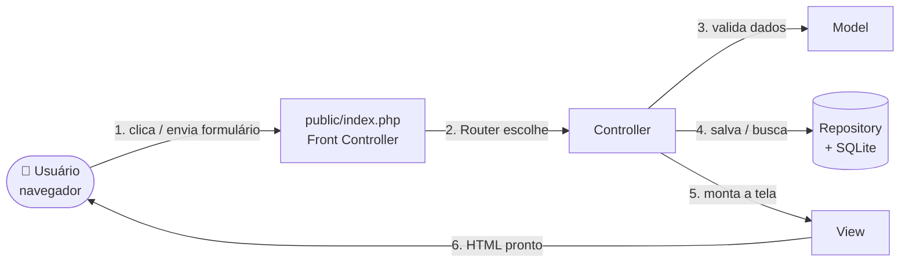
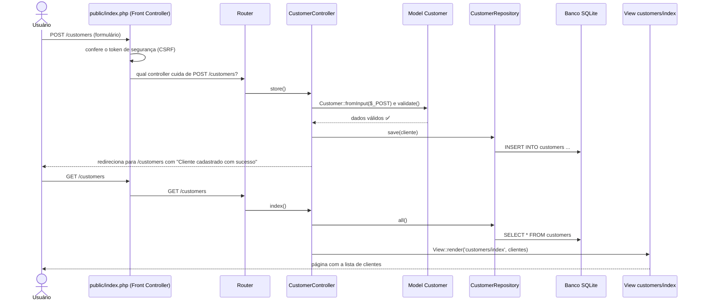

# Vitrine PDV — Sistema de Vendas em MVC

Sistema de **Ponto de Venda (PDV)** feito em **PHP + SQLite**, organizado na arquitetura **MVC** e usando **Design Patterns**. Ele é a continuação do sistema de PDV da aula: o formulário "Cadastro de Produtos" (código, nome, categoria, validade, quantidade, preço unitário, preço pacote e imagem) foi levado para dentro da arquitetura MVC, e foram criadas as telas pedidas na atividade.

> 💡 **Para quem não é da área:** pense neste sistema como o "caixa" de uma loja de perfumes. Você cadastra os clientes e os produtos, coloca os produtos no carrinho, finaliza a venda e depois consulta os relatórios para saber quanto vendeu.

---

## Sumário

1. [Checklist da atividade](#1-checklist-da-atividade)
2. [O que o sistema faz](#2-o-que-o-sistema-faz)
3. [O que é MVC (explicado de forma simples)](#3-o-que-é-mvc-explicado-de-forma-simples)
4. [Passo a passo: o caminho de um clique dentro do sistema](#4-passo-a-passo-o-caminho-de-um-clique-dentro-do-sistema)
5. [Mapa das pastas e arquivos](#5-mapa-das-pastas-e-arquivos)
6. [Design Patterns adotados](#6-design-patterns-adotados)
7. [CRUDs das telas](#7-cruds-das-telas)
8. [POP — Procedimento Operacional Padrão de implantação](#8-pop--procedimento-operacional-padrão-de-implantação)
9. [Roteiro de teste (primeiro uso)](#9-roteiro-de-teste-primeiro-uso)
10. [Segurança](#10-segurança)
11. [Glossário](#11-glossário)

---

## 1. Checklist da atividade

| Critério | Onde está no projeto | Seção do README |
|---|---|---|
| **MVC** (1 pt) | `app/Models/` (Model), `resources/views/` (View), `app/Controllers/` (Controller) | [3](#3-o-que-é-mvc-explicado-de-forma-simples), [4](#4-passo-a-passo-o-caminho-de-um-clique-dentro-do-sistema), [5](#5-mapa-das-pastas-e-arquivos) |
| **POP** (1 pt) | Procedimento de implantação passo a passo | [8](#8-pop--procedimento-operacional-padrão-de-implantação) |
| **Patterns** (1 pt) | Singleton, Repository, Factory, Service Layer, Front Controller, Template View | [6](#6-design-patterns-adotados) |
| **CRUDs** (1 pt) | 1 - Cadastro de clientes · 2 - Carrinho de vendas · 3 - Relatórios de vendas (+ Cadastro de produtos da aula) | [7](#7-cruds-das-telas) |

---

## 2. O que o sistema faz

| Tela | Para que serve |
|---|---|
| **Clientes** | Cadastrar, listar, editar e excluir clientes (nome, e-mail, telefone e CPF). |
| **Produtos** | Formulário da aula: código, nome, categoria, validade, quantidade, preço unitário, preço pacote e imagem. |
| **Carrinho** | Escolher produtos, mudar quantidades, remover itens, escolher cliente e forma de pagamento e finalizar a venda. O estoque é baixado automaticamente. |
| **Relatórios** | Ver todas as vendas, filtrar por data e situação, ver o total faturado, abrir o comprovante, cancelar uma venda (o estoque volta), excluir vendas canceladas e baixar uma planilha (CSV). |

Regras de negócio importantes:

- Não é possível vender mais do que existe em estoque.
- Produto **vencido** (validade anterior a hoje) aparece marcado e **não pode ser vendido**.
- Ao **cancelar** uma venda, os produtos voltam para o estoque.
- Só é possível **excluir** do relatório uma venda que já foi cancelada (para não "sumir" com dinheiro recebido).

---

## 3. O que é MVC (explicado de forma simples)

**MVC** significa **Model – View – Controller** (Modelo – Visão – Controlador). É uma forma de **organizar o código em três "departamentos"**, cada um com uma única responsabilidade. Assim, quem mexe no visual não quebra as regras, e quem mexe nas regras não quebra o visual.

### A analogia do restaurante 🍽️

| Restaurante | No MVC | No nosso sistema |
|---|---|---|
| **Cliente** sentado na mesa | Usuário | Você, usando o navegador |
| **Garçom**: anota o pedido, leva para a cozinha e traz o prato | **Controller** | `app/Controllers/` — recebe o clique, confere os dados e decide o que fazer |
| **Cozinha e despensa**: sabem as receitas e guardam os ingredientes | **Model** | `app/Models/` (regras e validações) + `app/Repositories/` (guardam e buscam no banco de dados) |
| **Prato montado** que chega à mesa | **View** | `resources/views/` — as telas HTML que você vê |

O garçom (Controller) **não cozinha**, a cozinha (Model) **não atende a mesa** e o prato (View) **não decide o que vai dentro dele**. Cada um faz só a sua parte.

### Desenho do fluxo



### As três camadas no projeto

**Model (o "cérebro" dos dados)** — `app/Models/` e `app/Repositories/`
- `Customer.php`: sabe o que é um cliente válido (nome obrigatório, e-mail e CPF no formato certo).
- `Product.php`: sabe o que é um produto válido (os campos do formulário da aula) e se ele está vencido.
- `Cart.php`: sabe guardar, somar, alterar e remover itens do carrinho.
- `Repositories/*`: são os únicos que "conversam" com o banco de dados (SQL).
- `Services/SaleService.php`: regra de negócio de finalizar e cancelar vendas.

**View (a "cara" do sistema)** — `resources/views/`
- Só contém HTML e a exibição dos dados; não tem regra de negócio nem SQL.
- `layout.php` é a "moldura" comum (menu, mensagens, rodapé) usada por todas as telas.

**Controller (o "garçom")** — `app/Controllers/`
- `CustomerController.php` → tela de clientes.
- `ProductController.php` → tela de produtos.
- `CartController.php` → tela do carrinho.
- `ReportController.php` → tela de relatórios.

---

## 4. Passo a passo: o caminho de um clique dentro do sistema

Exemplo real: **você cadastra a cliente "Maria" e clica em "Salvar cliente"**.



Em palavras simples:

1. **Você clica** em "Salvar cliente". O navegador envia os dados para o endereço `/customers`.
2. **Porta de entrada** (`public/index.php`): todo pedido entra por um único arquivo. Ele confere se o pedido veio mesmo da tela do sistema (token CSRF).
3. **Roteador** (`app/Core/Router.php`): olha o endereço e escolhe quem atende — aqui, o método `store()` do `CustomerController`.
4. **Controller** pede ao **Model** `Customer` para conferir os dados. Se faltar o nome, ele volta para o formulário com uma mensagem de erro.
5. Dados certos? O Controller pede ao **Repository** para gravar no banco de dados.
6. O Controller manda o navegador para a lista de clientes, com a mensagem de sucesso.
7. Na lista, o Controller busca os clientes pelo Repository e entrega à **View**, que monta o HTML que você vê.

O mesmo caminho vale para todas as telas; muda apenas o Controller, o Model e a View envolvidos.

---

## 5. Mapa das pastas e arquivos

```text
sistema-vendas-mvc/
├── public/                    ← única pasta visível na internet
│   ├── index.php              ← porta de entrada (Front Controller) e lista de rotas
│   ├── assets/app.css         ← cores e visual
│   └── uploads/               ← imagens dos produtos enviadas pelo formulário
├── app/
│   ├── Core/                  ← "motor" do sistema
│   │   ├── Database.php       ← conexão com o banco (Singleton) e criação das tabelas
│   │   ├── Router.php         ← decide qual Controller atende cada endereço
│   │   ├── View.php           ← desenha as telas dentro do layout
│   │   └── helpers.php        ← funções de apoio (dinheiro, segurança, mensagens)
│   ├── Models/                ← M: regras e validações dos dados
│   │   ├── Customer.php
│   │   ├── Product.php
│   │   └── Cart.php
│   ├── Repositories/          ← M: acesso ao banco (Repository)
│   │   ├── CustomerRepository.php
│   │   ├── ProductRepository.php
│   │   └── SaleRepository.php
│   ├── Services/              ← M: regras de negócio
│   │   ├── SaleService.php            ← finalizar e cancelar vendas (Service Layer)
│   │   ├── PaymentMethodFactory.php   ← cria a forma de pagamento (Factory)
│   │   └── Payment/                   ← Dinheiro, Crédito, Débito e PIX
│   └── Controllers/           ← C: recebem os cliques e coordenam tudo
│       ├── CustomerController.php
│       ├── ProductController.php
│       ├── CartController.php
│       └── ReportController.php
├── resources/views/           ← V: telas HTML
│   ├── layout.php             ← moldura comum (menu e rodapé)
│   ├── customers/             ← index.php (lista) e form.php (cadastro/edição)
│   ├── products/              ← index.php (lista) e form.php (formulário da aula)
│   ├── sales/                 ← cart.php (carrinho) e detail.php (comprovante)
│   ├── reports/index.php      ← relatório de vendas
│   └── errors/404.php         ← página não encontrada
├── storage/                   ← banco de dados SQLite (criado sozinho, não vai para o Git)
└── bootstrap.php              ← liga o sistema: sessão, carregamento automático de classes e banco
```

---

## 6. Design Patterns adotados

**Design Patterns** (padrões de projeto) são **soluções conhecidas e testadas para problemas que se repetem** na programação — como uma "receita de bolo" que todo programador reconhece.

### 6.1 Singleton — `app/Core/Database.php`
- **O que é:** garante que exista **apenas um** objeto de um tipo.
- **Analogia:** uma loja tem **um único cofre**; todos os funcionários usam o mesmo, ninguém cria um cofre novo.
- **No projeto:** `Database::connection()` abre a conexão com o banco só uma vez e devolve sempre a mesma. O construtor é `private`, então ninguém consegue criar outra conexão "por fora".
- **Por que usar:** economiza recursos e evita conexões duplicadas.

### 6.2 Repository — `app/Repositories/`
- **O que é:** uma classe que **esconde o banco de dados** e oferece métodos simples como `all()`, `find()`, `save()` e `delete()`.
- **Analogia:** o **estoquista** — você pede "me traga o produto 5" e ele sabe em qual prateleira está.
- **No projeto:** `CustomerRepository`, `ProductRepository` e `SaleRepository` são os únicos lugares com SQL. Os Controllers nunca escrevem SQL.
- **Por que usar:** se um dia trocarmos o SQLite por MySQL, só os Repositories mudam.

### 6.3 Factory — `app/Services/PaymentMethodFactory.php` + `app/Services/Payment/`
- **O que é:** uma "fábrica" que **cria o objeto certo** a partir de uma informação simples.
- **Analogia:** você diz ao caixa "vou pagar no PIX" e ele pega a **maquininha certa**.
- **No projeto:** `PaymentMethodFactory::create('PIX')` devolve um objeto `PixPayment`. Todas as formas (`CashPayment`, `CreditCardPayment`, `DebitCardPayment`, `PixPayment`) seguem a mesma interface `PaymentMethod`. Se o nome não existir, a fábrica recusa e a venda não é gravada.
- **Por que usar:** para criar uma nova forma de pagamento (ex.: boleto) basta criar uma classe e registrá-la na fábrica; o resto do sistema não muda.

### 6.4 Service Layer — `app/Services/SaleService.php`
- **O que é:** uma camada que concentra as **regras de negócio** que envolvem várias tabelas.
- **Analogia:** o **gerente** que confere tudo antes de fechar a venda.
- **No projeto:** `checkout()` confere estoque, validade e cliente, grava a venda e os itens e dá baixa no estoque — tudo dentro de uma **transação** (ou tudo dá certo, ou nada é gravado). `cancel()` devolve os itens ao estoque.
- **Por que usar:** evita vendas "pela metade" e deixa os Controllers simples.

### 6.5 Front Controller + Router — `public/index.php` e `app/Core/Router.php`
- **O que é:** **uma única porta de entrada** para todas as requisições.
- **Analogia:** a **recepção** de um prédio, que confere o crachá e indica a sala correta.
- **No projeto:** `index.php` verifica a segurança (CSRF) e o `Router` envia cada endereço ao Controller correto.

### 6.6 Template View (Layout) — `app/Core/View.php` e `resources/views/layout.php`
- **O que é:** uma moldura única reaproveitada por todas as telas.
- **No projeto:** menu, mensagens e rodapé ficam em `layout.php`; cada tela só preenche o "miolo".

---

## 7. CRUDs das telas

**CRUD** = as quatro operações básicas com dados: **C**reate (criar), **R**ead (ler/consultar), **U**pdate (atualizar) e **D**elete (excluir).

### 1 - Cadastro de clientes (`CustomerController`)

| Operação | Como fazer na tela | Rota |
|---|---|---|
| **Create** | Menu **Clientes** → **+ Novo cliente** → preencher → **Salvar cliente** | `GET /customers/create` e `POST /customers` |
| **Read** | Menu **Clientes** (lista) | `GET /customers` |
| **Update** | Botão **Editar** → alterar → **Salvar cliente** | `GET /customers/{id}/edit` e `POST /customers/{id}/update` |
| **Delete** | Botão **Excluir** → confirmar | `POST /customers/{id}/delete` |

### 2 - Carrinho de vendas (`CartController`)

| Operação | Como fazer na tela | Rota |
|---|---|---|
| **Create** | Menu **Carrinho** → escolher a quantidade → botão **+** | `POST /cart/items` |
| **Read** | O painel **Seu carrinho** mostra itens, subtotais e total | `GET /sales/new` |
| **Update** | Alterar a quantidade do item → **Atualizar** | `POST /cart/items/{id}` |
| **Delete** | **×** remove um item; **Esvaziar** limpa tudo | `POST /cart/items/{id}/remove` e `POST /cart/clear` |
| **Finalizar** | Escolher cliente e pagamento → **Finalizar venda** (gera a venda e baixa o estoque) | `POST /sales/checkout` |

### 3 - Relatórios de vendas (`ReportController`)

| Operação | Como fazer na tela | Rota |
|---|---|---|
| **Create** | A venda é criada ao **finalizar o carrinho** | `POST /sales/checkout` |
| **Read** | Menu **Relatórios**: lista, filtros por data/status, totais, **Detalhes** e **Exportar CSV** | `GET /reports`, `GET /sales/{id}`, `GET /reports/export` |
| **Update** | Botão **Cancelar**: muda a situação para "Cancelada" e devolve o estoque | `POST /sales/{id}/cancel` |
| **Delete** | Botão **Excluir** (só aparece em vendas canceladas) | `POST /sales/{id}/delete` |

### Extra - Cadastro de produtos da aula (`ProductController`)

| Operação | Como fazer na tela | Rota |
|---|---|---|
| **Create** | Menu **Produtos** → **+ Novo produto** → preencher e escolher a imagem → **Cadastrar** | `GET /products/create` e `POST /products` |
| **Read** | Menu **Produtos** (lista com imagem, validade e estoque) | `GET /products` |
| **Update** | **Editar** → alterar (a imagem é opcional na edição) → **Salvar produto** | `GET /products/{id}/edit` e `POST /products/{id}/update` |
| **Delete** | **Excluir** → confirmar (a imagem também é apagada) | `POST /products/{id}/delete` |

---

## 8. POP — Procedimento Operacional Padrão de implantação

> **POP** é um "manual de instruções" que qualquer pessoa pode seguir, sempre do mesmo jeito, para obter o mesmo resultado.

| Item | Descrição |
|---|---|
| **Objetivo** | Instalar e colocar o Vitrine PDV para funcionar em um computador ou servidor. |
| **Quem executa** | Qualquer pessoa com acesso ao computador (não é preciso saber programar). |
| **Tempo estimado** | 10 a 15 minutos. |
| **Materiais** | Computador com Windows, Linux ou macOS; internet; PHP 8.2 ou superior com as extensões `pdo_sqlite` e `fileinfo`. Não precisa de Composer nem de servidor de banco de dados. |
| **Resultado esperado** | Sistema abrindo no navegador em `http://localhost:8000`, com 3 produtos de exemplo. |

### Etapa 1 — Instalar o PHP

**Windows (mais fácil):**
1. Baixe e instale o **XAMPP** em <https://www.apachefriends.org> (vem com o PHP).
2. Abra o arquivo `C:\xampp\php\php.ini` no Bloco de Notas e confira se estas linhas **não** começam com `;` (se começarem, apague o `;` e salve):
   ```ini
   extension=pdo_sqlite
   extension=sqlite3
   extension=fileinfo
   ```

**Linux (Ubuntu/Debian):**
```bash
sudo apt update
sudo apt install php-cli php-sqlite3 git
```

**macOS (com Homebrew):**
```bash
brew install php git
```

**Verificação:** abra o terminal (no Windows, o "Prompt de Comando") e digite:
```bash
php -v
```
Deve aparecer `PHP 8.2` ou maior. Se aparecer "comando não encontrado", no Windows use o caminho completo `C:\xampp\php\php.exe -v`.

### Etapa 2 — Baixar o projeto

**Opção A (com Git):**
```bash
git clone https://github.com/pedro2donatodecampos-glitch/sistema-vendas-mvc.git
cd sistema-vendas-mvc
```

**Opção B (sem Git):** no GitHub, clique em **Code → Download ZIP**, extraia o arquivo e abra o terminal dentro da pasta extraída.

### Etapa 3 — Dar permissão de gravação (somente Linux/macOS)

O sistema grava o banco em `storage/` e as imagens em `public/uploads/`:
```bash
chmod 775 storage public/uploads
```
No Windows este passo não é necessário.

### Etapa 4 — Ligar o sistema

Dentro da pasta do projeto, execute:
```bash
php -S localhost:8000 -t public public/index.php
```
No Windows com XAMPP:
```bat
C:\xampp\php\php.exe -S localhost:8000 -t public public/index.php
```
Deixe essa janela **aberta** enquanto usar o sistema. Para desligar, pressione `Ctrl + C`.

### Etapa 5 — Abrir no navegador

Acesse <http://localhost:8000>. Na primeira vez o sistema cria sozinho o banco `storage/database.sqlite`, as tabelas e 3 produtos de exemplo.

✅ **Verificação final:** o menu mostra **Carrinho, Clientes, Produtos e Relatórios**, e o carrinho lista os produtos de exemplo.

### Etapa 6 — Rodar no GitHub Codespaces (sem instalar nada)

1. No GitHub, clique em **Code → Codespaces → Create codespace**.
2. No terminal que abrir, rode `php -S 0.0.0.0:8000 -t public public/index.php`.
3. Clique em **Open in Browser** quando o aviso da porta 8000 aparecer.

### Etapa 7 — Implantação em servidor/hospedagem (produção)

1. Use PHP 8.2+ com `pdo_sqlite` e `fileinfo`.
2. Envie os arquivos do projeto para o servidor.
3. Configure a **pasta pública (document root)** para `public/` — assim `storage/` e o código ficam inacessíveis pela internet.
4. Configure o servidor para enviar todas as rotas para `public/index.php`. No Apache, o arquivo `public/.htaccess` (já incluído no projeto) faz isso:
   ```apache
   RewriteEngine On
   RewriteCond %{REQUEST_FILENAME} !-f
   RewriteRule ^ index.php [L]
   ```
   Exemplo no Nginx: `try_files $uri /index.php?$query_string;`
5. Dê permissão de escrita ao usuário do servidor web em `storage/` e `public/uploads/`.
6. Use **HTTPS**.

### Etapa 8 — Backup e manutenção

- Todos os dados ficam em **um único arquivo**: `storage/database.sqlite`. Copie-o regularmente (ex.: diariamente) junto com a pasta `public/uploads/` (imagens).
- Para **restaurar**, desligue o sistema, coloque a cópia no mesmo lugar e ligue de novo.
- Para **zerar** o sistema, apague `storage/database.sqlite`; ele será recriado com os produtos de exemplo.

### Solução de problemas

| Problema | Causa provável | Solução |
|---|---|---|
| `could not find driver` | Extensão `pdo_sqlite` desligada | Ative `extension=pdo_sqlite` no `php.ini` (Etapa 1) |
| `Class "finfo" not found` ao enviar imagem | Extensão `fileinfo` desligada | Ative `extension=fileinfo` no `php.ini` |
| `Address already in use` | A porta 8000 já está em uso | Use outra porta: `php -S localhost:8080 -t public public/index.php` |
| "Sessão expirada" ao salvar | A página ficou aberta muito tempo | Atualize a página (F5) e tente de novo |
| Erro ao criar o banco ou salvar imagem | Sem permissão de gravação | Repita a Etapa 3 |
| Imagem recusada | Formato ou tamanho inválido | Use JPG, PNG, WEBP ou GIF de até 2 MB |

---

## 9. Roteiro de teste (primeiro uso)

1. **Produtos** → **+ Novo produto** → cadastre, por exemplo, *COD* `PER-010`, *Nome* `Far Away Glamour 50ml`, *Categoria* `Perfumaria`, validade futura, quantidade `10`, preços e uma foto do perfume → **Cadastrar**.
2. **Clientes** → **+ Novo cliente** → cadastre "Maria Silva" → **Salvar cliente**.
3. **Carrinho** → adicione 2 unidades do perfume com o botão **+**, altere a quantidade para 3 e clique em **Atualizar**.
4. Escolha a cliente "Maria Silva", a forma de pagamento **PIX** e clique em **Finalizar venda**. O comprovante aparece.
5. **Produtos** → confira que o estoque caiu de 10 para 7.
6. **Relatórios** → veja a venda, o total faturado e clique em **Exportar CSV** para abrir no Excel.
7. Clique em **Cancelar** na venda → o estoque volta para 10. Depois clique em **Excluir** para removê-la do histórico.

---

## 10. Segurança

- **Consultas preparadas (PDO):** impedem ataques de *SQL Injection*.
- **Escape de HTML** (`e()`): impede que textos digitados virem código na página (*XSS*).
- **Token CSRF** em todos os formulários: impede que outros sites enviem formulários em seu nome.
- **Upload seguro:** confere o tipo real do arquivo, limita a 2 MB e gera nomes aleatórios.
- **CSV seguro:** textos que começam com `=`, `+`, `-` ou `@` são neutralizados para não virarem fórmulas no Excel.
- **Transações:** a venda é gravada por completo ou não é gravada.

---

## 11. Glossário

| Termo | Significado simples |
|---|---|
| **PDV** | Ponto de Venda: o "caixa" da loja. |
| **MVC** | Model-View-Controller: forma de separar dados/regras, telas e controle. |
| **CRUD** | Criar, Ler, Atualizar e Excluir dados. |
| **Design Pattern** | Solução padrão e conhecida para um problema comum de programação. |
| **POP** | Procedimento Operacional Padrão: passo a passo que sempre gera o mesmo resultado. |
| **Rota** | Endereço da página, como `/customers`. |
| **SQLite** | Banco de dados que fica em um único arquivo, sem instalar servidor. |
| **Sessão** | Memória temporária do navegador; é onde o carrinho fica guardado até a venda ser finalizada. |
| **Transação** | Conjunto de operações no banco que acontecem todas juntas ou nenhuma. |
| **CSV** | Arquivo de planilha simples que abre no Excel ou no Google Planilhas. |
